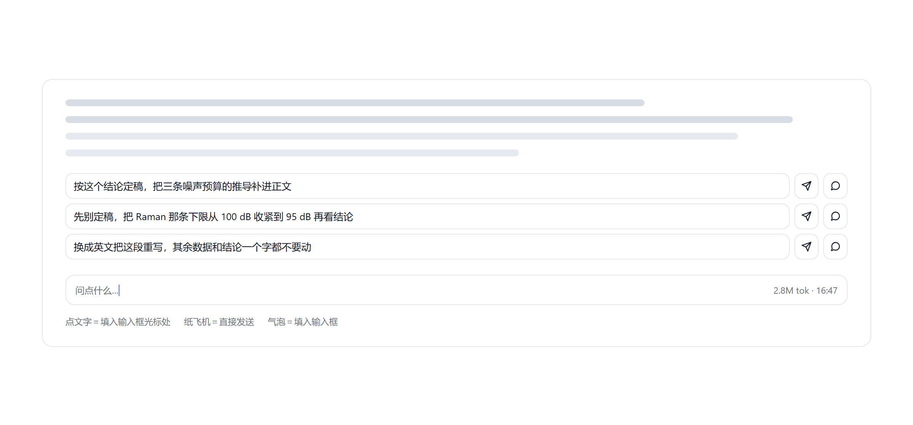

<div align="center">
  

# dsh-next-reply

English | [**简体中文**](README.md)


`v0.8.0` · DSH `0.2.2-rc.x` · Desktop / Web

**Three vertical next steps under every answer. Click the text to fill the composer; click a button to send it.**

The suggestions come from the reply itself — **no extra model call** — and the vertical layout lets each one be a full sentence instead of a four-word fragment.

<picture>
  <source media="(prefers-color-scheme: dark)" srcset="preview-dark.png">
  
</picture>

</div>

---

## 💡 What you get

The model writes the suggestions from that turn's answer. Because each one owns a full row and may wrap, it is usually a sentence you could send as-is:

| When the answer… | You will likely see |
| --- | --- |
| offers two options | "Go with plan A, leave step two alone" · "Switch to plan B and recompute step one" |
| dumps a pile of data | "Export the table as CSV so I can check it" · "Recompute at 1550 nm, everything else unchanged" |
| stops for your decision | "Lock this in and carry on" · "Hold on, I want to review it myself" |
| finishes without a next step | "Run the tests, then commit if they pass" · "Do not commit yet, show me the diff first" |

## ✨ Features

- After each completed turn, up to three **vertical** suggestions appear **above** that turn's action row.
- **Three click behaviours** (Settings → 下一步建议):

  | Mode | Clicking the text | Trailing buttons |
  |---|---|---|
  | **Smart** (default) | Fills the composer at the caret | Paper plane = send now; bubble = fill the composer |
  | Send | Sends immediately | none |
  | Fill | Fills the composer | none |

- **Never eats what you typed**: filling goes through `captureInsertion()` + `insertText()` — one undoable edit — and every *send* affordance greys out while a draft exists, instead of silently clearing it.
- **Full-width rows that wrap**: no more ellipsis, up to 160 characters kept.
- **Double-click guard**: the same action on the same sentence is accepted once per 900 ms.
- **The list freezes after a send**: it becomes "已发送：…" and nothing is clickable again.
- **Explains a missing list** on the settings page instead of leaving you guessing.
- Suggestions ship inside the reply you already paid for: **no added latency, no added cost per turn**.
- Delegated (sub-)agent sessions show nothing and receive no format instruction.
- Colours follow the DSH light/dark theme; everything greys out while a session runs or a submit is in flight.
- No dependencies, no build step; install and remove are one `dsh plugin` command each.

## 📦 Install

> **Since 0.7.0 this plugin is named `dsh-next-reply`, not `dsh-next-reply-chips`.** The old name receives no further updates; remove the old package before upgrading.

From GitHub (recommended):

```powershell
dsh plugin --profile desktop remove dsh-next-reply-chips
dsh plugin --profile desktop add "github:Charlieeeo/dsh-next-reply"
```

Or use **Settings → Plugins → Add plugin** and paste `github:Charlieeeo/dsh-next-reply`.

From npm:

```powershell
dsh plugin --profile desktop add dsh-next-reply
```

From a local checkout:

```powershell
dsh plugin --profile desktop add "E:\\path\\to\\dsh-next-reply"
```

Confirm it is enabled under **Settings → Plugins**. A **Host half** change needs a DSH restart; a **browser half** change needs only a page refresh.

> **The CLI only installs the package.** It must also appear in `dsh.profile.bundles` inside `~/.dsh/profiles/<profile>/package.json`, or the plugin route returns 404 and nothing loads. The in-app "Add plugin" flow does that step for you.

Uninstall:

```powershell
dsh plugin --profile desktop remove dsh-next-reply
```

## 🖱️ Usage

Nothing to configure: three suggestions appear under the next completed answer.

| Action | Effect |
| --- | --- |
| Click the suggestion text | Per the current mode: fill at the caret (smart/fill), or send (send) |
| Click the paper plane (smart only) | Goes out as your next message at once; greyed out while a draft exists |
| Click the bubble (smart only) | Inserts at the caret (undoable) without sending |
| Composer already has text | Every send control greys out with a `title` saying why; filling still works |

Switch the click behaviour under **Settings → 下一步建议**; it applies immediately, no restart.

To turn it off entirely: **Settings → Plugins → dsh-next-reply** and switch it off. That removes the suggestions, the settings page, the fence hider **and** the system-prompt section together, leaving no stale state.

## ⚙️ Configuration

The only state is one string, at `~/.dsh/next-reply.json`:

```json
{ "mode": "smart" }
```

`mode` is `smart`, `send` or `draft`; the default is `smart`.

**Upgrading never resets your choice**: a 0.7.x file holding the old `{ "directSend": true|false }` folds into `send` / `draft`, and `~/.dsh/next-reply-chips.json` (the 0.6.x name) plus the package-local `config.json` (0.5 and older) are still read in order. An older build reading the new shape folds it back the same way.

## 🩺 Why no suggestions appeared

The bottom of the settings page shows **recent turns with no suggestions**. It reads at most eight entries held **in Host memory** — cleared on restart, **never written to disk** — each with a time and a reason:

| Reason | Meaning | What to do |
| --- | --- | --- |
| The reply had no `suggest` marker | The model did not close with the format | Most common; just run another turn |
| A marker with no usable option | Everything inside was cleaned away | Run another turn |
| No assistant answer node | The turn is still running, or was interrupted | Wait for it to finish |
| No chat snapshot | The kernel snapshot shape differs from what this build expects | Open an issue with the reason |

Only the **newest turn** reports: a page reload replays every historical row, and an eight-slot ring filled with old turns would answer nothing.

## 🧠 Design decisions

Everything below was learned by hitting it, not by reasoning about it up front.

### Why the row went from horizontal pills to a vertical list

Three pills on one line leave each about 260 px, so anything longer is eaten by an ellipsis — and the eaten part is exactly the part that decides whether you want to send it. Hover-to-expand was a patch, not a fix. A vertical list gives each suggestion a full row that wraps, so the model can write a sentence you would actually send instead of a fragment you have to complete yourself.

The cost is vertical space, so the list is tightened: 6 px gaps, 13 px text, 10/4 px outer margins.

### Why "smart" mode exists, and why it is the default

With only two modes, every change of intent meant a trip to settings: fill when batching, send when committing. Those two intents alternate within a single turn.

Smart mode puts both actions beside each suggestion and makes the row text itself the **non-destructive** one. The default has to be that: any "a click sends" default costs a first-time user the sentence they were halfway through writing.

### Why `turn` is folded to a number first

`turnTail`'s owner prop is declared `turn: TurnLocation` — **an object, not a number**. The first version compared it directly against `node.location.turn`, so a number could never equal an object, every match failed, and the UI showed **nothing at all**, silently, with no error.

`turnOf()` now folds `3` / `{turn:3}` / `{kind:'turn',turn:3}` / `{turn:{turn:3}}` to a number before comparing, with a fallback that only accepts the closing answer when nothing can be folded.

### Why assistant messages are read by walking the value

A user message carries `data.content` blocks, but **an assistant step does not guarantee that shape** — it may be a flat `text` or pre-rendered markdown. Reading the assistant node with the user-message shape returned an empty string, so the marker was never found.

`textOf()` now tries the known shapes (`content[].text`, `data.text`, `data.markdown`) first, and only then walks the value while skipping structural keys — otherwise `type: "text"` itself leaks into the options.

### Why a click no longer uses `setDraft`

`setDraft(text)` **replaces the whole draft**. A user who had typed half a sentence and then clicked a suggestion lost that sentence, irreversibly.

Clicks now take a `captureInsertion()` span carrying `draftRev` and call `insertText(text, span)`: one undoable plain-text insert that returns `false` when the revision moved. On `false` it **does not fall back to `setDraft`** — better to do nothing than to trade a draft for a suggestion. `setDraft` survives only for an empty composer on a build without `insertText`.

### Why sending refuses while a draft exists

Sending calls `submit()`. With text already in the composer, any "clear then send" implementation is an **irreversible delete**. So a non-empty draft (or any attachment) greys out every send control, with a `title` saying "clear it first, or switch to fill". Filling stays enabled — that path inserts, it does not overwrite.

The trade-off is explicit: **any "clear it first, then send" implementation is an irreversible delete**, so a non-empty composer greys the send controls out instead of clearing them for you. Better that a click does nothing than that you lose the sentence you were writing.

### Why assistant text is read from `data.blocks`, and only `kind: 'text'`

This one was found by **replaying a real session log**; the unit suite was fully green and still missed it.

The kernel's client projection (`projectAssistant`) builds `data.blocks[]` for an assistant step:

```js
{ status, turn, step, blocks: [{ kind: 'text' | 'reasoning' | 'tool-call', text }], time }
```

Only a user message uses `data.content[]`. **The reader originally accepted `data.content` / `data.text` / `data.markdown` — none of which is the assistant shape.** It worked anyway because the fallback walk happened to pick up `blocks[].text`.

That accident had two real consequences:

1. The walk also joined `reasoning`, so a reasoning block that mentioned `suggest` could **invent buttons**;
2. Reasoning spliced between two prose blocks could **cut a fence in half**, making real buttons disappear.

The kernel's own `hasAssistantReplyContent` counts only `kind === 'text'` as the reply, excluding `reasoning` and `tool-call`. The reader now follows the same rule: read `data.blocks` and keep only `kind: 'text'`, then fall back to `content[]` / `text` / `markdown`, and only then walk the value.

`npm run test:real` runs that rule against a real log (165 assistant messages in this machine's session):

```
events whose reply text yields chips: 3
events with readable prose: 111/165
events where including reasoning WOULD change the result: 0
```

The 54 without readable prose were classified one by one: **every one is a pure tool-call step** (`tool-call` or `reasoning+tool-call`), which has no reply body at all.

### Why diagnostics stay off disk

Instrumentation is the easiest place to sneak in a log file, but this plugin's public promise is "one file on disk". So misses go into Host memory only, capped at eight, gone on restart, and the settings page reads them on demand. For finer work, `window.__NR_DIAG__ = true` in the console still prints the one-line shape report under the newest answer.

### Why the preference is not stored beside the package

`dsh plugin add github:...` installs into `node_modules`. Writing `config.json` there means an upgrade discards it, and some environments refuse the write.

It now lives at `~/.dsh/next-reply.json`. `localStorage` was rejected because the Web GUI origin carries a port that changes on every launch (observed `:52778` → `:21537` → `:32235`), which silently resets browser-scoped values.

### Why a plugin `Config` does not carry the preference

Beyond `Config` needing `@deepseek-ai/schemastery` (unresolvable for `link:` installs), there is a quieter trap: **writing `config` for the same `id` in the profile's `cordis.patch.yml` is silently ignored** — the profile patch is applied before the plugin's own insert row exists. Changing it means editing the patch inside the package and restarting.

Rather than ship a switch that has a coin-flip chance of doing nothing, the preference lives on its own route.

### Why there are zero dependencies

- A plugin `Config` form needs `@deepseek-ai/schemastery`, and a `link:`-installed package resolves bare imports from **its own** directory rather than the profile's `node_modules` — the form simply would not load for local installs.
- Declaring official `@deepseek-ai/*` `peerDependencies` brings a version trap: a range without a prerelease-tagged comparator on the target `major.minor.patch` tuple silently excludes prerelease builds, and an unmet peer **blocks installation**.

So the preference is a plain JSON file and the settings surface is a `settings.section` page. Slightly more code; installable from any path.

### Why the tests need a React stand-in that actually remembers state

The first stand-in's `useState` setter was a no-op, so the "freeze after send" test **could never reach that branch** — it asserted a path that never rendered. That is a green light for nothing. The stand-in now stores values in hook slots, resets between scenarios, and the frozen branch is genuinely rendered and asserted (no button survives it).

## ⭐ What sets this apart

Every claim below points at a place in the code. None of it is marketing.

### Zero extra model calls

The suggestions come from the **reply itself**, written as it closes. The plugin issues no model request at all — neither the client nor the host half contains an LLM call.

That means **no added latency and no added cost per turn**. A hundred turns a day is a hundred auxiliary calls not made, and no serial request to wait on.

The cost is stated plainly: a turn where the model ignores the format shows nothing. That is handled with a **visible diagnostic** (below) rather than with a call spent to erase it.

### It never overwrites what you typed

A click goes through `captureInsertion()` + `insertText(text, span)`: one **undoable** plain-text insert, guarded by a `draftRev` revision check that returns `false` when the draft moved under it.

On `false` it **does not fall back to `setDraft`** — better that nothing happens than that a draft is traded for a suggestion. `setDraft` survives only for an empty composer on a build without `insertText`.

Sending works the same way: while the composer holds text (or an attachment), every send control **greys out** with a `title` saying why. Any "clear it first, then send" implementation is an irreversible delete, and this plugin does not do that.

### One mode, both actions

Each suggestion carries two trailing buttons: **paper plane sends**, **bubble inserts at the caret**. Clicking the text itself is the non-destructive insert.

No trip to settings to change intent — batch-filling and committing both work on the same row. The default is insert because any "a click sends" default costs a first-time user the sentence they were halfway through writing.

### A vertical row lets a suggestion be a full sentence

Three suggestions stack vertically, each owning a full wrapping row, with a 160-character data cap and a prompt asking for 8–40 characters per item.

Three pills on one line leave each about 260 px, so anything longer is eaten by an ellipsis — and the eaten part is exactly what decides whether you would send it. Vertically, the model can write "hold off, tighten the Raman floor from 100 dB to 95 dB and re-check the conclusion" instead of a fragment you have to complete yourself.

### "Why did nothing appear" has a real answer

The bottom of the settings page lists **recent turns with no suggestions**, read from at most eight entries held in host memory, each with a time and a reason:

| Reason | Meaning |
| --- | --- |
| The reply had no `suggest` marker | The model did not close with the format (most common) |
| A marker with no usable option | Everything inside was cleaned away |
| No assistant answer node | Still running, or interrupted |
| No chat snapshot | The kernel snapshot shape differs from what this build expects |

Only the **newest turn** reports: a page reload replays every historical row, and an eight-slot ring filled with old turns would answer nothing. The reports stay **in memory, never on disk** — the plugin's promise is one file.

### It reads the kernel's real payload shape

An assistant step publishes `data.blocks[]` (`{kind: 'text'|'reasoning'|'tool-call', text}`), not the `data.content[]` a user message carries.

The reader takes **only `kind: 'text'`**, matching the kernel's own `hasAssistantReplyContent`. That detail matters: including `reasoning` lets a fence mentioned in thought invent buttons, and reasoning spliced between two prose blocks cuts a real fence in half.

This was found by **replaying a real session log**; 77 green unit tests had missed it. That is why the repo ships `npm run test:real`, which decompresses a real `session.v4.jsonl.zstd` and runs the reader over it.

### Zero dependencies, installable from any path

Both `dependencies` and `peerDependencies` are empty.

That is not fussiness. A plugin `Config` form needs `@deepseek-ai/schemastery`, and a `link:`-installed package resolves bare imports from **its own** directory, so the form simply would not load; and declaring official `@deepseek-ai/*` peers brings a version trap where prerelease builds are silently excluded and an unmet peer **blocks installation**.

So the preference is a plain JSON file and the settings surface is a `settings.section` page. Slightly more code; `dsh plugin add <any path>` works.

### A few engineering disciplines

- **77 component checks plus two probes**: the component suite, a preference-route probe (scratch files, never the real preference), and a real-log replay.
- **The test stand-in actually remembers state**: the first one's `useState` setter was a no-op, so the "freeze after send" test could never reach its branch — a green light for nothing. It now stores values in hook slots and resets between scenarios.
- **The previews are rendered from source**: `scripts/render-preview.mjs` reads the font size, both gaps, corner radius and icon box out of `lib/client.js` and refuses to render when any of them disagrees. Hand-drawn pictures drift — the previous preview still showed a pill row that no longer exists.
- **Every entry claim is checked against code**: `scripts/awesome-entry.mjs` validates the description line by line ("up to three" against `MAX_CHIPS`, "zero calls" against both halves, "inserts at the caret" against `captureInsertion`).

## 🔒 Data and privacy

- **No network access.** The plugin makes no external request.
- **No auxiliary model call.** Nothing is sent anywhere; no extra request per turn.
- The only round-trips are **same-origin** `GET/POST /plugins/dsh-next-reply/config` and `/plugins/dsh-next-reply/diag` — one string, and a reason string plus a turn number.
- The only file written is `~/.dsh/next-reply.json`; diagnostics stay in memory.
- No telemetry.

## 🧩 Compatibility

| Item | Value |
| --- | --- |
| Verified against | DSH `0.2.2-rc.5` |
| Slots used | `conversation.chat.turnTail`, `conversation.chat.markdown.fence`, `settings.section` |
| Standard props used | `useChat` / `useSession` / `useInput` / `inputActions`; without `useInput` it degrades to 0.6 behaviour |
| If a slot is missing | That cell does not render; everything else keeps working |
| Dependencies / peers / private | `0` / `0` / `false` |

## ⚠️ Known limitations

- Relies on the model following the format; **a turn that does not follow it shows nothing** — no error, no gap. The settings page records why.
- In smart mode each suggestion takes a full row, so three of them use noticeably more vertical space in a narrow window.
- With text already in the composer, every send control is inert by design (it never overwrites).
- A ```` ```suggest ```` block pasted by hand into a user message is swallowed by the same layer.
- Subagent sessions receive no format instruction, so their answers carry nothing.

## 🛠️ Development

```powershell
npm test                    # 77 component checks + the config probe
node test/smoke.mjs         # component checks only
node test/probe-config.mjs  # config route only (scratch file, never the real preference)
```

<details>
<summary><b>What the 77 checks cover</b></summary>

| Group | Coverage |
| --- | --- |
| Host half | injects `systemPrompt`; registers exactly one section; template carries the fence marker; the instruction now asks for 8–40 characters and states the row is vertical |
| Delegated agents | the root agent keeps the instruction, a child gets an empty string |
| Preference route | path and `kind`; GET default `smart`; each of the three modes persists and reads back; an unknown mode is 400 without touching the file; a legacy `{directSend}` body folds into a mode; unsupported method 405 |
| Diagnostic route | POST appends, GET reads back, timestamp shape; the ring caps at 8; a junk `turn` is dropped; DELETE 405 |
| Legacy migration | `{directSend:false}` stored under the old name folds into `draft` |
| Registration | exports `inject=['slots']`; `turnTail` at order 60; `settings.section` at order 55 with its Chinese label; the `suggest` hoc layer exists and returns `null` |
| Layout | the list is `flexDirection: column`; one row element per suggestion; the label is `whiteSpace: normal` and has neither an ellipsis nor the old 260 px cap |
| Parsing | three options; marker split across blocks; no marker returns `null`; turn scoping; truncation past three; duplicates and blanks dropped; `{turn:{turn}}` shape; JSON-array salvage; quote and bullet peeling; whitespace collapse; case-insensitive de-duplication; a long sentence survives; 160-character cap |
| Real payload shape | a marker inside `data.blocks`; a fence split across two text blocks; **a fence in a reasoning block renders nothing**; **reasoning does not cut a real fence**; a tool-call block is ignored; reasoning-only renders nothing; a pure tool step renders nothing; the old `content[]` shape does not regress |
| Send mode | `setDraft` + `submit`; guarded insert preferred when available; **a non-empty draft greys it out and it does nothing**; attachments count as a draft |
| Fill mode | inserts without submitting; stays enabled with a draft; a rejected insert **never degrades to `setDraft`**; falls back to `setDraft` on older builds |
| Smart mode | three controls per row; text only fills; the plane sends; the bubble only fills; with a draft the plane is disabled while text and bubble still work; the two icons have distinct accessible labels and distinct glyphs; it is the first, recommended settings option |
| Guards | one fire per action and sentence in 900 ms; text and bubble share the cooldown while send does not; a non-`plain` `phase` disables everything; a running session disables everything; **a send freezes the row and leaves no button**; a fill does not freeze |
| Robustness | a missing `inputActions` greys out without throwing; a malformed snapshot returns `null`; hover feedback covers all three controls; the settings page carries the diagnostic block; the client default matches the Host default; the suite owns scratch paths and leaves nothing behind |

</details>

Debugging a missing list: run `window.__NR_DIAG__ = true` in the browser console and reload. The newest answer then prints a one-line shape report (`turn`, `order` length, whether `nodes` is a map, trailing node kinds). Prefer the settings page block if you would rather not open a console.

## 📜 License

[MIT](LICENSE)
