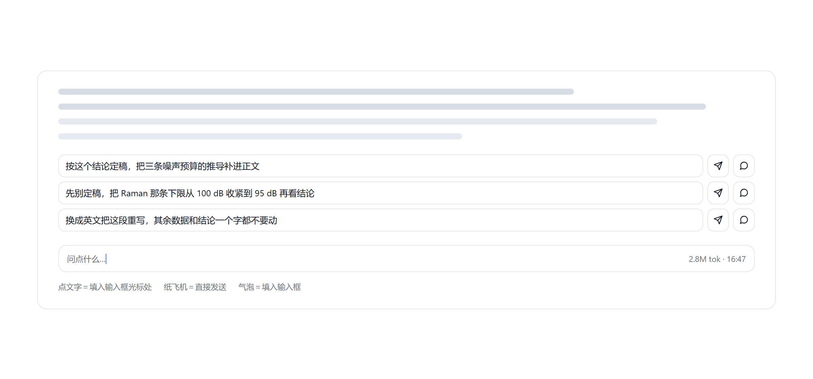

<div align="center">
  

# dsh-next-reply

**简体中文** | [English](README.en.md)


`v0.7.0` · DSH `0.2.2-rc.x` · 桌面 / Web

**每条回答下方，三个可以直接点的下一步。**

建议由主回复自身给出，**不额外调用模型**；点一下可以直接发出，也可以只填进输入框等你确认。

<picture>
  <source media="(prefers-color-scheme: dark)" srcset="preview-dark.png">
  
</picture>

</div>

---

## 💡 你能拿它做什么

药丸内容由模型按当轮回答生成，下面是它通常长什么样：

| 当回答是这样的 | 你很可能看到 |
|---|---|
| 给了两个方案 | 「按方案 A 继续」「换成方案 B」 |
| 摆了一堆数据 | 「先把表导成 CSV」「按 1550 nm 重算」 |
| 停在需要你拍板的地方 | 「就按这个定」「先不动，我要复核」 |
| 做完了但没说下一步 | 「跑一下测试」「把改动提交」 |

## ✨ 功能

- 每轮回答结束后，在本轮动作行**上方**显示最多 3 个药丸按钮。
- 点击行为可切换：**直接发送**（默认），或**填入输入框**、你改完再自己发。
- **不覆盖你正在打的字**：填入走 `captureInsertion()` + `insertText()` 的一次可撤销插入；直接发送模式下输入框一有草稿就**不发送**，按钮置灰并说明原因。
- **悬停展开全文**：药丸默认按 260 px 省略号收着，鼠标移上去（或键盘聚焦）展开成整句。
- **防连点**：同一条建议 900 ms 内只认一次点击，避免手抖发两条。
- **点击后本轮冻结**：发送成功后整行换成「已发送：…」，不会再被重复点。
- **为什么没出药丸**，设置页直接告诉你原因（见下）。
- 建议随主回复一起产出，**每轮零附加延迟、零附加费用**。
- 代理（子）会话不显示药丸，也不会被注入格式指令。
- 颜色跟随 DSH 深浅主题；会话进行中时按钮置灰。
- 无依赖、无构建步骤；装与卸都是 `dsh plugin` 一条命令。

## 📦 安装

> **0.7.0 起本插件已从 `dsh-next-reply-chips` 改名为 `dsh-next-reply`。** 旧名不再更新；升级请先移除旧包。

从 GitHub（推荐）：

```powershell
dsh plugin --profile desktop remove dsh-next-reply-chips
dsh plugin --profile desktop add "github:Charlieeeo/dsh-next-reply"
```

或在 **设置 → 插件 → 添加插件** 里粘贴 `github:Charlieeeo/dsh-next-reply`。

从 npm（版本固定，市场能显示下载量）：

```powershell
dsh plugin --profile desktop add dsh-next-reply
```

从本地目录：

```powershell
dsh plugin --profile desktop add "E:\\path\\to\\dsh-next-reply"
```

装完在 **设置 → 插件** 确认已启用。**主机半**改动需要重启 DSH；**浏览器半**改动只需刷新页面。

> **CLI 只负责装包。** 用 CLI 装时，`~/.dsh/profiles/<profile>/package.json` 的 `dsh.profile.bundles` 里也要有 `"dsh-next-reply"`，否则插件路由 404、什么都不加载。设置页里的「添加插件」会替你处理这一步。

卸载：

```powershell
dsh plugin --profile desktop remove dsh-next-reply
```

## 🖱️ 使用

装好后无需配置：下一轮回答结束，药丸就出现在回答下方。

| 操作 | 效果 |
| --- | --- |
| 点药丸 | 按下面的设置发送，或填入输入框 |
| 悬停 / 聚焦 | 展开被省略号收着的整句 |
| 输入框里已有字 | 直接发送模式下按钮置灰，不覆盖草稿 |

点击行为在 **设置 → 下一步建议** 里切换：

| 选项 | 点击后 |
| --- | --- |
| **直接发送**（默认） | 立刻作为你的下一条消息发出，但只在输入框为空时 |
| **填入输入框，待我确认** | 插到光标处（可撤销），你可以改完再自己发 |

想彻底关掉：**设置 → 插件 → dsh-next-reply** 关闭开关。这会同时移除药丸、设置页、代码块隐藏层和系统提示指令，不会留下脏状态。

## ⚙️ 配置

唯一的状态是一个布尔值，存在 `~/.dsh/next-reply.json`：

```json
{ "directSend": false }
```

`~/.dsh/next-reply-chips.json`（0.6.x 用的名字）和包目录里的 `config.json`（0.5 及更早）仍会被读取，所以升级不会把你的选择重置掉。

## 🩺 为什么没出药丸

设置页底部有一小块「最近没有出现建议的轮次」。它读的是**主机端内存里最多 8 条**记录（重启即清空、**不落盘**），每条写明时间和原因：

| 原因 | 意思 | 怎么办 |
| --- | --- | --- |
| 回答里没有 suggest 标记 | 模型这一轮没按格式收尾 | 最常见，重开一轮即可 |
| 有标记但没有可用选项 | 标记里的内容全被清洗掉了 | 换一轮 |
| 本轮没有助手回答节点 | 这一轮还在跑，或被中断 | 等它结束 |
| 拿不到会话快照 | 内核快照结构和本插件预期不符 | 报 issue，附上原因 |

只有**最新一轮**才会记一条：整页刷新会把所有历史轮次重放一遍，八格环形缓冲塞满旧数据就什么都答不上了。

## 🧠 设计取舍

这一节记录的每一条，都是**实测撞出来之后才敢写**的，不是设计时的猜测。

### 为什么 `turn` 要先折成数字

`turnTail` 的 owner prop 声明是 `turn: TurnLocation`——**是对象，不是数字**。第一版直接拿它与 `node.location.turn` 比较，数字永远不等于对象，于是每次匹配都失败，界面**静默**没有药丸、也不报错。

现在 `turnOf()` 会把 `3` / `{turn:3}` / `{kind:'turn',turn:3}` / `{turn:{turn:3}}` 全部折成数字再比；折不出来时还有一个兜底：只认「收尾回答」，避免旧轮次重复显示。

### 为什么助手消息要按"猜不到就遍历"来读

用户消息的载荷是 `data.content` 的块数组，但**助手消息不保证是这个形状**——可能是扁平 `text`，也可能是渲染好的 markdown。第一版按用户消息的结构去读助手节点，取到空字符串，于是永远找不到标记。

现在先试已知形状（`content[].text` / `data.text` / `data.markdown`），都落空才遍历整个值，并跳过 `type`/`kind`/`role` 这类结构键——否则 `type: "text"` 这个值会被当成正文混进选项里。

### 为什么点击不再用 `setDraft`

`setDraft(text)` 会**整块替换**草稿：用户打了半句话，点一下药丸，那半句就没了，而且不可撤销。

现在走 `captureInsertion()` 拿一个带 `draftRev` 的选区，再 `insertText(text, span)`：一次可撤销的纯文本插入，版本对不上就返回 `false`。返回 `false` 时**不再退化成 `setDraft`**——宁可这次不生效，也不拿草稿换建议。只有输入框确实为空、且内核没有 `insertText`（老版本）时才用 `setDraft`。

### 为什么"直接发送"会拒绝

直接发送要 `submit()`。如果输入框里有草稿，任何"先清空再发送"的实现都是**不可撤销的删除**。所以这一模式下，`useInput` 报出非空草稿（或带附件）时按钮直接置灰，`title` 写明「清空后再点，或改成填入输入框」。填入模式下不置灰——那里是插入，不覆盖。

这里刻意和同类插件反着来：有的实现选择"先清空原草稿"让点击永远有效。我们选数据不丢。

### 为什么诊断不落盘

排查类功能最容易顺手写个日志文件，但这个插件的公开承诺是「唯一落盘文件是那一个 JSON」。所以诊断只进主机端内存，八条封顶，重启即空，设置页按需读。要更细的排查再开浏览器控制台的 `window.__NR_DIAG__ = true`，那一行会直接印在最新回答下方。

### 为什么偏好不写在包目录

`dsh plugin add github:...` 会把包装进 `node_modules`。第一版把 `config.json` 写在包目录，那样一旦升级就会被覆盖，某些环境还可能只读。

现在落在 `~/.dsh/next-reply.json`。没用 `localStorage`，是因为 Web GUI 的 origin 带端口、且这个端口在每次启动时都会变（实测见过 `:52778` → `:21537` → `:32235`），浏览器域内的值会莫名复位。

### 为什么不用插件 `Config` 承载偏好

除了 `Config` 需要 `@deepseek-ai/schemastery`（`link:` 安装时解析不到），还有一个更隐蔽的坑：**写在 profile 的 `cordis.patch.yml` 里改同一 `id` 的 `config` 会被静默忽略**——profile 补丁先于插件自己的插入行应用，那时这条行还不存在。要改只能改包内的 `cordis.patch.yml` 并重启。

与其让一个开关有一半概率改了没反应，不如把它放在自己的路由上。

### 为什么坚持零依赖

- 插件 `Config` 表单需要 `@deepseek-ai/schemastery`，而 `link:` 安装的包是从**自己目录**解析裸模块，不是 profile 的 `node_modules`——表单在本地安装时根本加载不出来。
- 声明官方 `@deepseek-ai/*` 的 `peerDependencies` 有版本陷阱：范围里若没有与目标 `major.minor.patch` 同元组、且自带预发布标签的比较符，预发布版会被静默排除；而 peer 不满足会**直接阻断安装**。

所以偏好是一个普通 JSON 文件，设置面是一个 `settings.section` 页面。代价是多写了点代码，收益是从任何路径都能装。

### 为什么测试不能用真实配置文件

早期的测试会读写包目录里的 `config.json`，某次跑完直接把使用者存的偏好删了。现在测试通过 `DSH_NR_CONFIG_FILE` / `DSH_NR_LEGACY_CONFIG_FILES` 指向临时路径，**完全不碰**真实文件。

## 🔀 与同类插件比，我们取了什么、拒了什么

做 0.7.0 时横向读了四个同类项目。下面每一条都写清"为什么不跟"，而不是只列优点。

| 项目 | 它的核心做法 | 我们取了 | 我们没取，因为 |
| --- | --- | --- | --- |
| [dsh-prompt-predict](https://github.com/ferrisching/dsh-prompt-predict) | 输入框内 ghost text，Tab 采纳，Esc 忽略，↻ 换一条 | 本轮"已处理"语义；`captureInsertion` 的版本 CAS 思路 | 它**每轮额外调一次模型**；ghost 与药丸是同一件事的两种画法，两者都做只会更挤 |
| [dsh-next-input](https://github.com/songshuhuoban/dsh-next-input) | 用输入框占位文字给一条建议，Tab 填入 | **`captureInsertion()` + `insertText()`**（本版最实质的改动）；请求/轮次/时间戳的竞态丢弃；诊断可查 | 它同样每轮调一次模型，并为此维护长会话滚动摘要与磁盘缓存——我们零调用，不需要 |
| [dsh-suggest-actions](https://github.com/hiJoeLee/dsh-suggest-actions) | Host 注册 `suggest_actions` 工具，模型收尾时调用一次 | **防连点 900 ms**；**悬停展开全文**；轮次尾部渲染（我们本来就在） | 不改成"工具调用"通道：那会进工具列表、占一次工具轮次、子代理也看得见，而我们的格式指令可以按 agent 关掉。另外它点击会**先清空原草稿**，我们反着来 |
| [dsh-wdx-relief](https://github.com/wdxtub/dsh-wdx-relief) | 八个低心智负担功能打包，全走插件 `Config` | "先给结果和下一步"的文案取向；失败退回本地的降级习惯 | 它的进度条/会话回顾需要后台反复调便宜模型；它走 `Config` 是因为装了依赖包，我们零依赖装不了 |

一句话总结这轮的分歧点：**同类插件普遍用「每轮多调一次模型」换格式无关，我们坚持「零调用」换零延迟零费用**，代价是模型不按格式收尾的那一轮没有药丸——所以本版把这件事做成**可见的诊断**，而不是靠加调用去消灭它。

## 🔒 数据与隐私

- **不联网**。插件不发起任何外部请求。
- **不额外调用模型**。没有辅助请求，没有把会话内容发到别处。
- 唯一的网络往返是**同源**的 `GET/POST /plugins/dsh-next-reply/config` 与 `/plugins/dsh-next-reply/diag`，前者只读写一个布尔值，后者只写原因字符串与轮次号。
- 唯一的落盘文件是 `~/.dsh/next-reply.json`；诊断只在内存里。
- 不采集任何遥测。

## 🧩 兼容性

| 项 | 说明 |
| --- | --- |
| 实测内核 | DSH `0.2.2-rc.5` |
| 依赖槽位 | `conversation.chat.turnTail`、`conversation.chat.markdown.fence`、`settings.section` |
| 依赖标准 props | `useChat` / `useSession` / `useInput` / `inputActions`；缺 `useInput` 时退化成 0.6 的行为 |
| 槽位缺失时 | 那一格不渲染，其余功能照常 |
| 依赖 / peer / private | `0` / `0` / `false` |

## ⚠️ 已知限制

- 依赖模型遵守格式；**不遵守格式的那一轮没有药丸**——不报错、不留空行。现在能在设置页看到这一轮被记了原因。
- 输入框里已有草稿时，**直接发送**模式下的药丸不可点（这是故意的：不覆盖你的字）。想让它继续可用就切到「填入输入框」。
- 用户消息里若手动粘贴 ```` ```suggest ```` 代码块，也会被同一个隐藏层吞掉。
- 子代理会话拿不到格式指令，因此它们的回答里不会出现药丸。

## 🛠️ 开发

```powershell
node test/smoke.mjs
```

<details>
<summary><b>51 项测试覆盖了什么</b></summary>

| 分组 | 覆盖 |
| --- | --- |
| 主机段 | 注入 `systemPrompt`；只注册一条 section；模板含代码块标记 |
| 代理会话 | 根代理保留指令、子代理返回空串 |
| 偏好路由 | 注册路径与 `kind`；GET 默认值；POST 落盘并可回读；非布尔载荷 400 且不改文件；不支持的 405 |
| 诊断路由 | POST 追加、GET 回读、时间戳格式；环形缓冲封顶 8 条；非法 `turn` 被丢弃；DELETE 405 |
| 旧值迁移 | 旧名字下的值仍能被读到 |
| 注册 | 导出 `inject=['slots']`；`turnTail` 序位 60；`settings.section` 序位 55 与中文标题；`suggest` hoc 层存在且返回 `null` |
| 解析 | 三选项；跨块标记；无标记返回 `null`；轮次隔离；超过 3 项截断；重复与空项丢弃；`{turn:{turn}}` 形态；JSON 数组兜底；剥引号与列表符；空白折叠；不分大小写去重；80 字截断 |
| 交互 | 发送模式 `setDraft` + `submit`；有 `insertText` 时优先走 `captureInsertion` + `insertText`；填入模式只插入不提交；**草稿非空时发送模式置灰且不动作**；附件也算草稿；插入被拒时**不退化成 `setDraft`**；同一条 900 ms 内只发一次；`phase` 非 `plain` 全部置灰；悬停展开并复原 |
| 健壮性 | 缺 `inputActions` 不抛错且置灰；畸形快照返回 `null`；设置页含诊断块；插件自身读取临时文件、不留残留 |

</details>

调试"药丸没出现"：在浏览器控制台执行 `window.__NR_DIAG__ = true` 并刷新，最新一条回答下方会打印一行形状诊断（`turn`、`order` 长度、`nodes` 是否 map、尾部节点种类）。不想开控制台就看设置页底部的诊断块。

## 📜 许可

[MIT](LICENSE)
